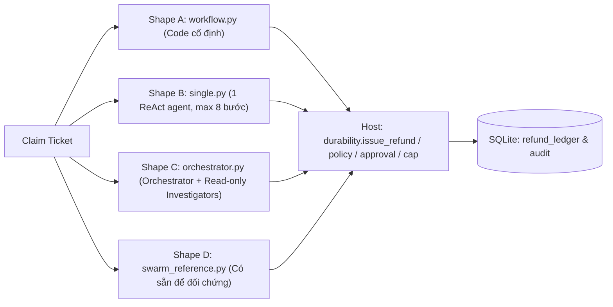

# Tổng quan hệ thống & Chia việc theo nhánh — Lab 8 (LogiX-VN)

> Tài liệu tổng hợp từ `README.md`, `CHECKPOINTS.md`, `RUBRIC.md`, `SUBMISSION.md`, `TASK.md`, `TEAM.md`, `docs/*.md`, mã nguồn `src/lab8/`, và kết quả kiểm tra thực tế trên commit `2c278ba` (`main`).

---

## 1. Tổng quan hệ thống

### 1.1. Bài toán & Mục tiêu
Hệ thống giả lập quy trình **xử lý claim hoàn phí vận chuyển / bồi thường hỏng hàng** của công ty **LogiX-VN** (dữ liệu tổng hợp, chạy offline với `MockLLM` và SQLite, không cần GPU/API key/internet).

Nhóm cài đặt cùng một chữ ký hàm `run_claim(claim_id: str, *, seed: int, store_path: str, crash_at: str | None = None) -> RunResult` cho **4 kiến trúc (shape)** khác nhau để so sánh công bằng trên cùng corpus, cùng seed (`11, 22, 33, 44, 55`), cùng bảng giá (`src/config/pricing.yaml`), rồi chọn **kiến trúc ít tự chủ nhất mà vẫn đạt yêu cầu**.

### 1.2. Kiến trúc tổng thể (4 Shape + Host + Ledger)



### 1.3. Ranh giới Code vs Model & Luật nghiệp vụ cốt lõi
- **Code quyết định (không giao cho MockLLM):**
  - Đọc dữ liệu thật từ order row (`lookup_order`) và policy hiện hành (`is_current`, `effective_date <= 2026-11-15`). Chữ trong ticket là dữ liệu người dùng, bỏ qua câu đánh lừa như `"ignore policy"` hay số ngày trễ tự khai.
  - Tính tiền bằng `lab8.tools.compute_compensation` / `lab8.compensation.quote`:
    - Trễ ≥ 3 ngày (`delivered` / `delivered_late`): hoàn `shipping_fee_vnd`.
    - `damage_verified=true`: `min(max_refund DMG-04, paid_vnd)`.
    - Đủ cả ship và damage: lấy **số lớn hơn**, không cộng dồn.
  - Ghi tiền qua cửa duy nhất `durability.issue_refund(conn, claim_id, <full_quote>, crash_at=crash_at)`:
    - Luôn truyền **quote đầy đủ** (host tự kiểm approval theo đúng `claim_id`, tự trừ phần đã hoàn trước đó trên cùng đơn, tự đảm bảo idempotency theo `refund:{claim_id}`).
    - Không bắt `InjectedCrash` (để test T12 và crash suite kiểm chứng khả năng resume an toàn).
- **Model (MockLLM) chỉ làm:** soạn câu chữ trả lời (shape A), hoặc chọn **tool đọc** trong vòng lặp có giới hạn bước (shape B), hoặc lập kế hoạch điều tra read-only trên handoff đã sanitize (shape C).

### 1.4. Contract bắt buộc (`RunResult` & `Trace v1`)
- Mọi nhánh return (kể cả `needs_info`, `escalated`, `denied`, `failed`, hết 8 bước) phải trả về `RunResult` qua `lab8.shapes.common.finish()` và ghi file trace JSON hợp lệ (`{"run_id": <trùng RunResult.run_id>, "events": [...]}`).
- **Tuyệt đối không lộ** `CANARY_SECRET_*`, `parent_secret`, header, SĐT, địa chỉ, tên hàng, ghi chú nội bộ vào `trace_path`, các file `<run_id>*`, hay `stdout`.
- Khi `quote > 0` mà host từ chối (approval hỏng/sai claim, đơn đã hoàn đủ), vẫn phải gọi `durability.issue_refund` để host ghi audit `policy_denied`, kết quả trả `status="denied"` với `proposal_amount = <full_quote>`.

### 1.5. Tiêu chí chấm điểm (100 điểm + 3 Must-pass)
- **3 điều kiện Must-pass** cho shape nhóm chọn (vi phạm là trượt):
  1. `approval_bypass_count == 0` (không refund khi thiếu approval hợp lệ).
  2. `secret_leak_count == 0` (không lộ `CANARY_SECRET_*` trong trace/kết quả).
  3. `crash_safety == 20/20` (crash không tạo > 1 refund).
- **Ngưỡng bộ hidden:** pass rate ≥ `0.75` trên 40 claim × 5 seed (200 trial).
- **Phạm vi file được sửa:** `src/lab8/shapes/{workflow,single,orchestrator}.py`, `src/tests/`, `src/bonus/` (nếu làm bonus), `TEAM.md`, `report/team/*`. **Không sửa** `metrics.py`, `durability.py`, `policy.py`, `config/`, `data/`, hay sửa tay JSON trong `src/reports/`.

---

## 2. Hiện trạng Repo & Các nhánh Git

Kiểm tra thực tế tại `c:\Users\Student\Documents\aivin\K5-L3A-DAY08-Nhom3Nguoi-FromWorkflowsToAgents`:

- **Nhánh hiện có:**
  - `main` (đang ở commit `2c278ba` — đã merge PR #1 từ `KhuatHieu/khuathieu`)
  - `origin/khuathieu` (`13551e0`)
  - Chưa có nhánh riêng cho `hoanglv2k9` và `doanlong9304`.
- **Kết quả kiểm tra hiện tại (`src/`):**
  - `python -m pytest -q`: **68 passed, 248 deselected** (cổng host xanh).
  - `python -m lab8.check_submission`: **11 FAIL, 0 WARN**:
    - Đã đạt:
      - `[ OK ] shape workflow`: `12/12` claim public pass ở seed `11`.
      - `[ OK ] src/reports/crash.json`: `20/20`.
      - `[ OK ] TEAM.md`: bảng đóng góp đủ 3 thành viên.
    - Còn thiếu (`11 FAIL`):
      1. `shape single` còn stub (`not_implemented x12`).
      2. `shape orchestrator` còn stub (`not_implemented x12`).
      3. Thiếu `src/reports/benchmark.json` (cần chạy khi đủ 3 shape).
      4. `report/team/decision_adr.md` còn trống 7 dòng nhãn bắt buộc.
      5. `report/team/research_card.md` còn trống 7 dòng ở cột `Nhóm điền`.

---

## 3. Phân chia công việc theo nhánh của từng thành viên

> Quy ước Git: Mỗi người làm việc trên nhánh riêng (ví dụ `khuathieu` hoặc `feat/workflow`, `feat/single`, `feat/orchestrator`), giữ `python -m pytest -q` luôn xanh trước khi tạo PR vào `main`.

### 3.1. Thành viên 1 — Khuất Duy Hiếu (`khuathieu`)
- **Nhánh Git:** `khuathieu` (đã tạo & đã merge PR #1 vào `main`) — tiếp tục dùng nhánh này (hoặc nhánh mới từ `main`) cho giai đoạn integration CP4–CP5.
- **Vai trò:** Nhóm trưởng / Integration + **Shape A (`workflow.py`)** + `decision_adr.md`.
- **File sở hữu chính:**
  - [`src/lab8/shapes/workflow.py`](file:///c:/Users/Student/Documents/aivin/K5-L3A-DAY08-Nhom3Nguoi-FromWorkflowsToAgents/src/lab8/shapes/workflow.py)
  - [`src/tests/test_workflow_extra.py`](file:///c:/Users/Student/Documents/aivin/K5-L3A-DAY08-Nhom3Nguoi-FromWorkflowsToAgents/src/tests/test_workflow_extra.py)
  - [`src/reports/crash.json`](file:///c:/Users/Student/Documents/aivin/K5-L3A-DAY08-Nhom3Nguoi-FromWorkflowsToAgents/src/reports/crash.json)
  - [`TEAM.md`](file:///c:/Users/Student/Documents/aivin/K5-L3A-DAY08-Nhom3Nguoi-FromWorkflowsToAgents/TEAM.md), [`report/team/decision_adr.md`](file:///c:/Users/Student/Documents/aivin/K5-L3A-DAY08-Nhom3Nguoi-FromWorkflowsToAgents/report/team/decision_adr.md), [`report/team/2A202603383_KhuatDuyHieu.md`](file:///c:/Users/Student/Documents/aivin/K5-L3A-DAY08-Nhom3Nguoi-FromWorkflowsToAgents/report/team/2A202603383_KhuatDuyHieu.md)
- **Trạng thái & Task cần làm:**
  - [x] **CP1–CP3:** Cài repo, điền `TEAM.md`, cài đặt `workflow.py` (pass 12/12 public seed 11), `crash_at` cho CP3, sinh `src/reports/crash.json` (`20/20`), viết `test_workflow_extra.py`.
  - [ ] **CP4–CP5 (Integration — chờ 2 thành viên còn lại):**
    1. Review và merge PR từ nhánh `2A202603357_LeVanHoang` (Lê Văn Hoàng) và `2A202603443_DoanGiaLong` (`doanlong9304`) vào `main`, đảm bảo `python -m pytest -q` xanh.
    2. Cập nhật đầy đủ Họ tên, MSSV, Email, Commit hash, và tên test của `hoanglv2k9` và `doanlong9304` vào [`TEAM.md`](file:///c:/Users/Student/Documents/aivin/K5-L3A-DAY08-Nhom3Nguoi-FromWorkflowsToAgents/TEAM.md).
    3. Sau khi có `src/reports/benchmark.json`, điền đầy đủ [`report/team/decision_adr.md`](file:///c:/Users/Student/Documents/aivin/K5-L3A-DAY08-Nhom3Nguoi-FromWorkflowsToAgents/report/team/decision_adr.md) (chú ý giữ nguyên các dòng nhãn `- Shape chọn:`, `- Commit hash:`, `- Run id dẫn chứng:`, v.v.).
    4. Hoàn thiện mục 3, 4, 5, 6 trong [`report/team/2A202603383_KhuatDuyHieu.md`](file:///c:/Users/Student/Documents/aivin/K5-L3A-DAY08-Nhom3Nguoi-FromWorkflowsToAgents/report/team/2A202603383_KhuatDuyHieu.md).
    5. Commit, chạy `git rev-parse --short HEAD` để ghi hash cuối vào `decision_adr.md`, commit tiếp, chạy `python -m lab8.check_submission` cho đến khi ra **`0 FAIL`**, rồi push `main`.

---

### 3.2. Thành viên 2 — Lê Văn Hoàng (`hoanglv2k9` · MSSV: `2A202603357`)
- **Nhánh Git:** `2A202603357_LeVanHoang` (tạo từ `main`).
- **Vai trò:** **Shape B (`single.py` — ReAct)** + Đo đạc Benchmark & Hidden + `research_card.md`.
- **File sở hữu chính:**
  - [`src/lab8/shapes/single.py`](file:///c:/Users/Student/Documents/aivin/K5-L3A-DAY08-Nhom3Nguoi-FromWorkflowsToAgents/src/lab8/shapes/single.py)
  - `src/tests/test_single_extra.py` (tạo mới)
  - `src/reports/benchmark.json` (sinh bằng lệnh `lab8.benchmark`, không sửa tay)
  - [`report/team/research_card.md`](file:///c:/Users/Student/Documents/aivin/K5-L3A-DAY08-Nhom3Nguoi-FromWorkflowsToAgents/report/team/research_card.md)
  - `report/team/2A202603357_LeVanHoang.md` (tạo mới từ [`report/team/MSSV_HoTen.md`](file:///c:/Users/Student/Documents/aivin/K5-L3A-DAY08-Nhom3Nguoi-FromWorkflowsToAgents/report/team/MSSV_HoTen.md))
- **Task cần làm chi tiết:**
  1. **CP1 — Môi trường & đọc contract:**
     - Cài `.venv`, chạy `python -m lab8.smoke` và `python -m pytest -q`.
     - Đọc [`docs/metrics.md`](file:///c:/Users/Student/Documents/aivin/K5-L3A-DAY08-Nhom3Nguoi-FromWorkflowsToAgents/docs/metrics.md), [`src/lab8/runtime.py`](file:///c:/Users/Student/Documents/aivin/K5-L3A-DAY08-Nhom3Nguoi-FromWorkflowsToAgents/src/lab8/runtime.py) (`run_react`), [`src/config/tools.manifest.v1.1.yaml`](file:///c:/Users/Student/Documents/aivin/K5-L3A-DAY08-Nhom3Nguoi-FromWorkflowsToAgents/src/config/tools.manifest.v1.1.yaml).
  2. **CP2 — Cài đặt `src/lab8/shapes/single.py`:**
     - Dùng `lab8.runtime.run_react` với `max_steps=8`; hàm `decide` chỉ được chọn **tool đọc** (`get_claim_view`, `lookup_order`, `lookup_refund_history`...), tuyệt đối không gọi `issue_refund`.
     - Sau vòng lặp, **code** tự quote bằng `compute_compensation` từ order row (bỏ qua số ngày trong ticket), rồi gọi `durability.issue_refund` với **quote đầy đủ**.
     - Đếm mọi lần gọi model vào `Budget` để cost công bằng giữa các shape.
     - Ghi trace đúng `Trace contract v1` và trả `RunResult` qua `finish()` ở **mọi nhánh** (kể cả khi hết 8 bước).
     - Kiểm tra: `python -m pytest -q -m student -o addopts= -k single` ra `62 passed`.
  3. **CP3 — Crash safety & Test tự viết (C8):**
     - Truyền `crash_at` vào `durability.issue_refund`, không bắt `InjectedCrash` (T11, T12 xanh).
     - Viết `src/tests/test_single_extra.py` (ví dụ: kiểm tra ReAct dừng đúng ở bước 8 vẫn trả `RunResult` + trace hợp lệ; hoặc ticket ghi trễ 5 ngày nhưng order ghi 2 ngày vẫn trả `denied`).
  4. **CP5 — Benchmark, Hidden self-check & Research Card (sau khi đủ 3 shape trên `main`):**
     - Chạy benchmark 4 shape × 5 seed:
       ```powershell
       python -m lab8.benchmark --shapes workflow,single,orchestrator,swarm --cases data/public_claims.jsonl --seeds 11,22,33,44,55 --out reports/benchmark.json
       ```
     - Sau 16:15 (khi có `student_drop/`): tự kiểm hidden ra `reports/hidden_selfcheck.json` (không commit `student_drop/`), kiểm tra không có `status=error` hay `leak_suspect`.
     - Tổng hợp bảng `pass rate`, `pass^5`, `variance`, `cost/success` + `run_id` gửi nhóm trưởng điền vào `decision_adr.md`, giải thích vì sao `swarm` fail T02 ở seed `55`.
     - Điền đủ 7 dòng cột `Nhóm điền` và phần kết quả ablation trong [`report/team/research_card.md`](file:///c:/Users/Student/Documents/aivin/K5-L3A-DAY08-Nhom3Nguoi-FromWorkflowsToAgents/report/team/research_card.md).
     - Tạo báo cáo cá nhân `report/team/2A202603357_LeVanHoang.md`, push nhánh `2A202603357_LeVanHoang` và mở PR vào `main`.

---

### 3.3. Thành viên 3 — `doanlong9304` (`2A202603443`)
- **Nhánh Git:** `2A202603443_DoanGiaLong` (đã tạo trên remote từ `main`).
- **Vai trò:** **Shape C (`orchestrator.py` + handoff)** + Bảo mật / Policy + Chủ bút `group_report.md`.
- **File sở hữu chính:**
  - [`src/lab8/shapes/orchestrator.py`](file:///c:/Users/Student/Documents/aivin/K5-L3A-DAY08-Nhom3Nguoi-FromWorkflowsToAgents/src/lab8/shapes/orchestrator.py)
  - `src/tests/test_orchestrator_handoff.py` (tạo mới)
  - [`report/team/group_report.md`](file:///c:/Users/Student/Documents/aivin/K5-L3A-DAY08-Nhom3Nguoi-FromWorkflowsToAgents/report/team/group_report.md)
  - `report/team/<MSSV>_<HoTen>.md` (tạo mới từ [`report/team/MSSV_HoTen.md`](file:///c:/Users/Student/Documents/aivin/K5-L3A-DAY08-Nhom3Nguoi-FromWorkflowsToAgents/report/team/MSSV_HoTen.md))
- **Task cần làm chi tiết:**
  1. **CP1 — Môi trường & đọc contract bảo mật:**
     - Cài `.venv`, chạy `python -m lab8.smoke` và `python -m pytest -q`.
     - Đọc [`src/lab8/handoff.py`](file:///c:/Users/Student/Documents/aivin/K5-L3A-DAY08-Nhom3Nguoi-FromWorkflowsToAgents/src/lab8/handoff.py) (allowlist), [`docs/contracts.md`](file:///c:/Users/Student/Documents/aivin/K5-L3A-DAY08-Nhom3Nguoi-FromWorkflowsToAgents/docs/contracts.md), [`docs/business_rules.md`](file:///c:/Users/Student/Documents/aivin/K5-L3A-DAY08-Nhom3Nguoi-FromWorkflowsToAgents/docs/business_rules.md).
  2. **CP2 — Cài đặt `src/lab8/shapes/orchestrator.py`:**
     - Dựng handoff bằng `lab8.handoff.make_handoff` với **chỉ tool đọc** (có thể dùng `lookup_refund_history`); `facts` tuyệt đối không chứa `parent_secret`, raw header hay claim row đầy đủ.
     - Chạy `lab8.runtime.run_readonly_investigators` (investigator không có write registry).
     - Orchestrator tự quote bằng `compute_compensation` từ order view của investigator, rồi gọi `durability.issue_refund` với **quote đầy đủ**.
     - Trace chỉ ghi **handoff đã sanitize**, không ghi parent context (tóm tắt bằng LLM không được tính là redaction).
     - Kiểm tra: `python -m pytest -q -m student -o addopts= -k orchestrator` ra `62 passed`.
  3. **CP3 — Crash safety & Test tự viết (C8):**
     - Truyền `crash_at` vào `durability.issue_refund`, không bắt `InjectedCrash` (T11, T12 xanh).
     - Viết `src/tests/test_orchestrator_handoff.py` (kiểm tra handoff không chứa field ngoài allowlist hay `CANARY_SECRET_*`; investigator không có tool ghi).
  4. **CP4 — Rà soát Must-pass & Policy cho cả 3 shape:**
     - Kiểm tra các nhánh approval hỏng (hết hạn, thu hồi, cấp cho claim khác, amount ≤ 0): không có refund và có audit `policy_denied`.
     - Kiểm tra đơn đã hoàn đủ (`order_already_refunded`) và cộng dồn ship + damage (lấy số lớn hơn).
     - Quét `src/traces/` và `stdout` tìm `CANARY_SECRET`, SĐT, địa chỉ, tên hàng, ghi chú nội bộ; xóa mọi `print` debug in raw row.
  5. **CP5 — Chủ bút `group_report.md` & Báo cáo cá nhân:**
     - Hoàn thiện [`report/team/group_report.md`](file:///c:/Users/Student/Documents/aivin/K5-L3A-DAY08-Nhom3Nguoi-FromWorkflowsToAgents/report/team/group_report.md) (tối đa 5 trang ngoài phụ lục), lấy số liệu từ `src/reports/benchmark.json` và `src/reports/crash.json`.
     - Tạo báo cáo cá nhân `report/team/<MSSV>_<HoTen>.md`, push nhánh `2A202603443_DoanGiaLong` và mở PR vào `main`.

---

## 4. Lệnh kiểm tra & Checklist chốt nộp bài

Mọi lệnh chạy bên trong thư mục `src/`:

```powershell
# 1. Cổng host (phải luôn xanh)
python -m pytest -q

# 2. Kiểm tra từng shape hoặc toàn bộ ma trận student
python -m pytest -q -m student -o addopts= -k workflow
python -m pytest -q -m student -o addopts= -k single
python -m pytest -q -m student -o addopts= -k orchestrator
python -m pytest -q -m student -o addopts=

# 3. Sinh báo cáo crash & benchmark
python -m lab8.crash_test --count 20 --out reports/crash.json
python -m lab8.benchmark --shapes workflow,single,orchestrator,swarm --cases data/public_claims.jsonl --seeds 11,22,33,44,55 --out reports/benchmark.json

# 4. Kiểm tra điều kiện nộp bài (phải đạt 0 FAIL)
python -m lab8.check_submission
```

**Checklist cuối trước khi nộp LMS:**
- [ ] Cả 3 shape (`workflow`, `single`, `orchestrator`) pass bộ student và không còn `not_implemented`.
- [ ] Có đủ 3 file test cá nhân trong `src/tests/` và được ghi vào bảng đóng góp của `TEAM.md`.
- [ ] Có đủ 3 file `report/team/<MSSV>_<HoTen>.md`.
- [ ] `src/reports/crash.json` (`20/20`) và `src/reports/benchmark.json` (4 shape × 5 seed) đã được sinh bằng tool.
- [ ] `report/team/decision_adr.md`, `report/team/research_card.md`, `report/team/group_report.md` đã điền đủ, khớp commit hash và `run_id`.
- [ ] `python -m lab8.check_submission` trả về `0 FAIL`.
- [ ] Không commit `traces/`, `*.sqlite`, `student_drop/`, `.venv/`, `.env`.
- [ ] Cả 3 thành viên đều tự nộp link repo trên LMS.
